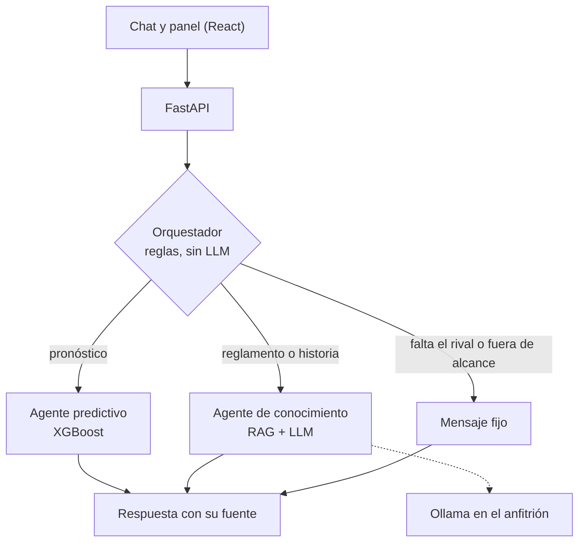

# Sistema multiagente de analítica de fútbol (LaLiga)

Proyecto de tesis. Un chat y un panel web que responden dos tipos de pregunta sobre **LaLiga Primera División**:

- **Pronósticos de un partido** (victoria local, empate, victoria visitante) con un modelo XGBoost entrenado con la forma reciente de cada equipo.
- **Dudas de reglamento, competición e historia**, respondidas con un RAG sobre documentos oficiales y citando documento y página.

Cada respuesta indica su fuente: conocimiento (con documento y página) o predicción.

## Los tres agentes

| Agente | Qué hace | Cómo |
|---|---|---|
| **Orquestador** | Decide a quién va cada pregunta (`prediccion`, `conocimiento`, `aclarar` o `fuera_de_alcance`) | Reglas deterministas, sin LLM. Devuelve el `motivo` de su decisión |
| **Conocimiento (RAG)** | Responde sobre reglamento, competición e historia | ChromaDB (coseno) + BM25 fusionados con RRF, y un LLM local (Ollama `qwen2.5:7b`) detrás de LangChain |
| **Predictivo** | Probabilidades de un partido entre dos equipos | XGBoost con 12 features de forma (últimos 5 partidos) |



Diagramas de componentes, de flujo y de secuencia, y las decisiones con su porqué: [`docs/arquitectura.md`](docs/arquitectura.md).

## Requisitos

| Para | Necesitas |
|---|---|
| Ambos modos | [Ollama](https://ollama.com) corriendo en tu máquina con el modelo descargado: `ollama pull qwen2.5:7b`. Se probó en una GPU de 6 GB; en CPU será más lento |
| Docker | Docker con Compose v2 |
| Desarrollo | Python 3.10 o superior (el entorno de desarrollo y la imagen usan 3.14), Node.js y npm |
| Datos | La carpeta `data/` con `modelo_predictivo_laliga.pkl`, `team_matches.csv` y `chroma_index_v2/`. Ver la sección siguiente: **no vienen completos en el repositorio** |

Sin servicios de pago: todo corre en local.

## Qué NO está en el repositorio

Un `git clone` **no basta para arrancar**: faltan los datos derivados. Esto es lo que hay y lo que no (según `git ls-files` y `.gitignore`):

| Archivo en `data/` | ¿En Git? | Cómo se obtiene |
|---|---|---|
| `modelo_predictivo_laliga.pkl` | Sí | Ya viene. Se puede regenerar con el notebook 02 |
| `la_liga_2014_2025_all_matches_final.csv` (datos crudos) | **No** (`data/*.csv` está ignorado) | **Hay que aportarlo.** Ver «Créditos» sobre su procedencia |
| Los 5 PDF del corpus: `Primera_y_Segunda_Division.pdf` (Normas de Competición 2026/27), `reglamento laliga 2025-2026.pdf`, `Reglas de Juego 2026_27_paginas individuales.pdf` y los 2 de Wikipedia (`Primera División de España…`, `El Clásico…`) | **No** (`data/*.pdf` está ignorado: son de terceros y el repo es público) | **Hay que aportarlos**, cada uno desde su fuente. Ver `docs/datos.md` |
| `df_final_features.csv` y `team_matches.csv` | **No** | Los genera el notebook 01 |
| `chroma_index/` (índice v1) y `chroma_index_v2/` | **No** (`data/chroma_index*/`) | Los generan los notebooks 03 y 05 |

El CSV crudo y los PDF **no se suben al repositorio**: el CSV tiene licencia incierta (ver «Créditos») y los PDF son documentos de terceros. Cada persona debe aportar su copia.

### Cómo regenerarlo, paso a paso

1. Crea el entorno e instala las dependencias. Los notebooks necesitan algunas librerías que no están en `backend/requirements.txt`:
   ```bash
   python -m venv venv
   source venv/bin/activate
   pip install -r backend/requirements.txt
   pip install jupyter matplotlib shap pdfplumber pymupdf langchain-text-splitters
   ```
2. Coloca en `data/` los 6 archivos que debes aportar: `la_liga_2014_2025_all_matches_final.csv` y los 5 PDF del corpus (fuentes en `docs/datos.md`).
3. Ejecuta los notebooks **en este orden**, cada uno con *Restart & Run All*, desde la carpeta `notebooks/` (usan rutas `../data/`):

   | Orden | Notebook | Lee | Escribe |
   |---|---|---|---|
   | 1 | `01_eda_partidos` | CSV crudo | `df_final_features.csv`, `team_matches.csv` |
   | 2 | `02_modelo_baseline` | `df_final_features.csv` | `modelo_predictivo_laliga.pkl` (sobrescribe el versionado) |
   | 3 | `03_rag_corpus` | 4 PDF que debes aportar (`reglamento laliga 2025-2026`, Reglas de Juego, los 2 de Wikipedia) | `chroma_index/` |
   | 4 | `05_corpus_v2` | `Primera_y_Segunda_Division.pdf` y Reglas de Juego (PDF que debes aportar) y `chroma_index/` | `chroma_index_v2/` |

   El 03 va antes del 05 porque el 05 rescata de `chroma_index/` los fragmentos ya limpios de Wikipedia. El `04_agente_conocimiento` es exploratorio y no hace falta.
4. Si Chroma da errores de base de datos, usa una carpeta nueva y no reutilices una corrupta.

**No verificado:** la regeneración completa (notebooks 01 → 02 → 03 → 05) no se ha comprobado de extremo a extremo. Tampoco se ha probado desde un entorno virtual
limpio (la lista de `pip install` de arriba es la esperada, no una comprobada), ni *Restart & Run All* dentro de Jupyter, ni con PDF y CSV aportados por otra persona.

## Inicio rápido

### Modo Docker

```bash
ollama pull qwen2.5:7b          # una vez; Ollama debe estar corriendo en el anfitrión
docker compose up --build       # primera vez: unos 10 min y varios GB; después, segundos
```

- Interfaz: <http://localhost:8080>
- API y documentación OpenAPI: <http://localhost:8000/docs>
- Parar: `docker compose down` (no borra nada de `data/`).

Ollama **no** va en el contenedor: se usa el del anfitrión (GPU y modelos ya descargados). El contenedor lo alcanza en
`host.docker.internal:11434`; para otro modelo: `OLLAMA_MODEL=qwen2.5:3b docker compose up` (también existe `OLLAMA_BASE_URL`).
Más detalle, medidas y qué no se probó: [`docs/despliegue.md`](docs/despliegue.md).

### Modo desarrollo

```bash
cp .env.example .env            # opcional: DATA_DIR y OLLAMA_MODEL. El .env no se sube a Git

# Terminal 1: backend (desde la raíz del repo, con el entorno virtual activado)
cd backend
uvicorn app.main:app --port 8000

# Terminal 2: frontend
cd frontend
npm install
npm run dev                     # http://127.0.0.1:5173
```

Comprobación rápida de la API:

```bash
curl -s localhost:8000/health
curl -s -X POST localhost:8000/preguntar -H 'content-type: application/json' \
  -d '{"pregunta": "¿Cuántos puntos se dan por una victoria?"}'
```

El backend carga el modelo, el CSV y el índice al arrancar y falla enseguida si falta alguno. Otros comandos del frontend: `npm run build` y `npm run lint` (ver [`frontend/README.md`](frontend/README.md)).

### Pruebas

```bash
pip install -r backend/requirements-dev.txt
cd backend
python -m pytest tests -v
```

Usa `python -m pytest` y no `pytest` a secas: así `backend/` queda en el `sys.path` y `from app import ...` funciona. Hoy hay 4 pruebas, todas
sobre un único riesgo: que `dias_desde_ultimo_partido` se calcule en inferencia distinto que al entrenar (ver `docs/datos.md`). No hay pruebas automáticas
del orquestador ni del RAG; esos se miden con los scripts de `backend/scripts/`.

## Resultados

Cifras tomadas de [`docs/mediciones.md`](docs/mediciones.md), con la fecha de cada medición. Hardware: portátil con RTX 4050 de 6 GB, WSL2.

| Qué | Resultado | Fecha |
|---|---|---|
| Modelo: log-loss en prueba (1.140 partidos desde 2022-08-01) | **1,0513** frente a 1,0663 de la línea base | 02/11/2026 |
| Modelo: calibración (ECE medio / Brier multiclase) | 0,0816 / 0,6337 | 02/11/2026 |
| Recuperación: sección correcta entre los 8 fragmentos | 17/17 (preguntas de desarrollo) | 01/11/2026 |
| RAG: hecho clave en la respuesta, sin RAG frente a con RAG | 4/11 frente a **9/11** (mismo LLM, mismas 11 preguntas) | 02/11/2026 |
| RAG tras el ajuste del léxico (desarrollo, 11 preguntas) | frase clave 11/11, respuesta 10/11 | 02/11/2026 |
| RAG **held-out** (10 preguntas, ejecutado una vez) | frase clave **9/10**, respuesta **9/10** | 02/11/2026 |
| Orquestador, desarrollo (27 casos, reglas ajustadas viendo fallos) | 27/27 | 02/11/2026 |
| Orquestador **held-out** (12 casos, congelado, ejecutado una vez) | **12/12** | 02/11/2026 |
| LLM: 7B frente a 3B (11 preguntas, `/chat`) | 9/11 y 2.853 ms frente a 7/11 y 1.347 ms | 01/11/2026 |
| Latencia de `/preguntar` | predicción 299 ms; conocimiento 4.018 ms (una medición) | 02/11/2026 |

Cómo leerlas: los conjuntos son pequeños (10 a 27 casos) y los redactó la misma persona que ajustó el sistema. Con 9/10 el intervalo de Wilson al 95 %
es de unos 60 a 98 %. Un 100 % del orquestador no garantiza que generalice.

## Limitaciones

- **Datos hasta el 2025-05-25.** No se actualizan (el origen probable prohíbe el rastreo; ver `docs/datos.md`). Los pronósticos usan la forma de los
  últimos 5 partidos a esa fecha y no reflejan fichajes, lesiones ni resultados posteriores. Sin fecha, la predicción usa el último dato + 7 días (2025-06-01).
  Equipos que no jugaron en Primera en 2024/25 (Cádiz, Almería, Granada) arrastran la forma de temporadas anteriores.
- **El modelo aporta poco y está descalibrado.** Mejora la línea base en 0,015 de log-loss. Sobreestima el empate (predice 0,34, ocurre 0,26) y subestima la
  victoria local (predice 0,34, ocurre 0,45). Se propuso calibrar con Platt, pero no se aplicó porque exige reentrenar y tocar el `.pkl`. Tómense las
  probabilidades como orientativas.
- **Latencia del LLM de 7B.** El objetivo es responder en menos de 5 s. De media se cumple, pero el 7B roza o supera los 5 s en algunas preguntas
  (conmoción cerebral y desempate: 4,9 a 6,0 s). La primera pregunta tras arrancar paga la carga en frío: el calentamiento del 7B tardó 18,2 s y la
  primera búsqueda 4,4 s frente a 0,14 s en caliente. El 3B es unas 2 veces más rápido pero acierta menos y a veces contesta solo con citas.
- **Fallos conocidos del RAG.** «¿Cuántos suplentes…?» responde «cinco» (pregunta ambigua; fallo de generación). En el held-out, la duración máxima de la prórroga
  no llegó a los fragmentos y el sistema contestó «No encontré esa información» (abstención correcta, no alucinación). La métrica de «hecho clave» es generosa.
- **El orquestador solo entiende su vocabulario.** Lo que no reconoce cae en `aclarar` o `fuera_de_alcance`. Por ejemplo, «¿Cuántos goles marcó el Barça al Madrid?» se declina.
  No extrae la fecha del texto, solo del campo opcional `fecha`. Ver `docs/diseno_orquestador.md`.
- **Alcance de la liga y del corpus.** Solo Primera División; los artículos de Segunda se excluyen salvo que la pregunta diga «segunda». El corpus es de la
  temporada 2026/27, y no contiene datos como quién ganó un clásico concreto.
- **Despliegue.** Solo probado con Docker Desktop sobre WSL2 y amd64. La interfaz se probó contra el backend real pero no en un navegador real. El LLM de despliegue final sigue pendiente.
- **Dependencia de los PDF.** Reproducir el índice exige aportar el CSV y los 5 PDF del corpus, que no están en Git.

## Estructura del repositorio

```text
.
├── backend/
│   ├── app/                  FastAPI y agentes: main, orquestador, chat (RAG + LLM), retrieval, prediction
│   ├── scripts/              evaluaciones (recuperación, respuestas, orquestador, calibración, held-out)
│   │   ├── datos_evaluacion/   preguntas del held-out de RAG
│   │   └── datos_orquestador/  casos dev y heldout del router
│   ├── tests/                pruebas con pytest
│   ├── requirements.txt      dependencias de ejecución
│   ├── requirements-dev.txt  añade pytest
│   └── Dockerfile
├── frontend/                 React + Vite: chat y panel de predicción (nginx en Docker)
├── notebooks/                01 EDA y features, 02 modelo, 03 y 05 corpus RAG, 04 exploración
├── data/                     datos (ver «Qué NO está en el repositorio»)
├── docs/                     arquitectura, datos, mediciones, despliegue, orquestador, frontend y figuras
├── docker-compose.yml
├── .env.example
└── CLAUDE.md                 decisiones del proyecto y convenciones
```

## Documentación

[`arquitectura`](docs/arquitectura.md) · [`mediciones`](docs/mediciones.md) · [`datos`](docs/datos.md) · [`despliegue`](docs/despliegue.md) · [`orquestador`](docs/diseno_orquestador.md) · [`frontend`](docs/frontend.md)

## Créditos y licencias de datos

- **Partidos (`la_liga_2014_2025_all_matches_final.csv`).** Procedencia **inferida, no confirmada**: por su esquema (`match_id`, `xg`, `ppda`, `xpts`, `deep`) parece un
  export de [Understat](https://understat.com). El archivo no trae metadatos de origen, así que **su licencia es incierta** y por eso no se redistribuye. Debe verificarse la
  procedencia exacta antes de citarla. Respetamos el `robots.txt` de Understat: no se hace ningún rastreo.
- **Reglas de Juego 2026/27.** Texto del IFAB (International Football Association Board), usado como fuente de consulta del RAG. Los derechos pertenecen al IFAB.
- **Normas de Competición Primera y Segunda División 2026/27 y reglamento de LaLiga 2025-2026.** Documentos normativos de LaLiga, usados como fuente de consulta del RAG.
  Los derechos pertenecen a sus titulares.
- **Wikipedia** («Primera División de España» y «El Clásico»). Texto bajo licencia [CC BY-SA 4.0](https://creativecommons.org/licenses/by-sa/4.0/deed.es), con atribución a sus autores.
- **Modelo de embeddings:** `paraphrase-multilingual-MiniLM-L12-v2` (sentence-transformers). **LLM:** `qwen2.5` servido localmente por Ollama.

Este proyecto es académico. No tiene afiliación con LaLiga, el IFAB ni Understat.
