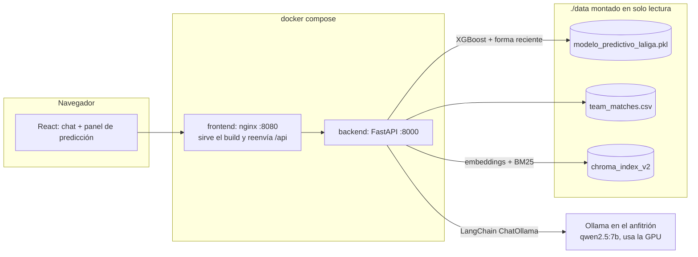
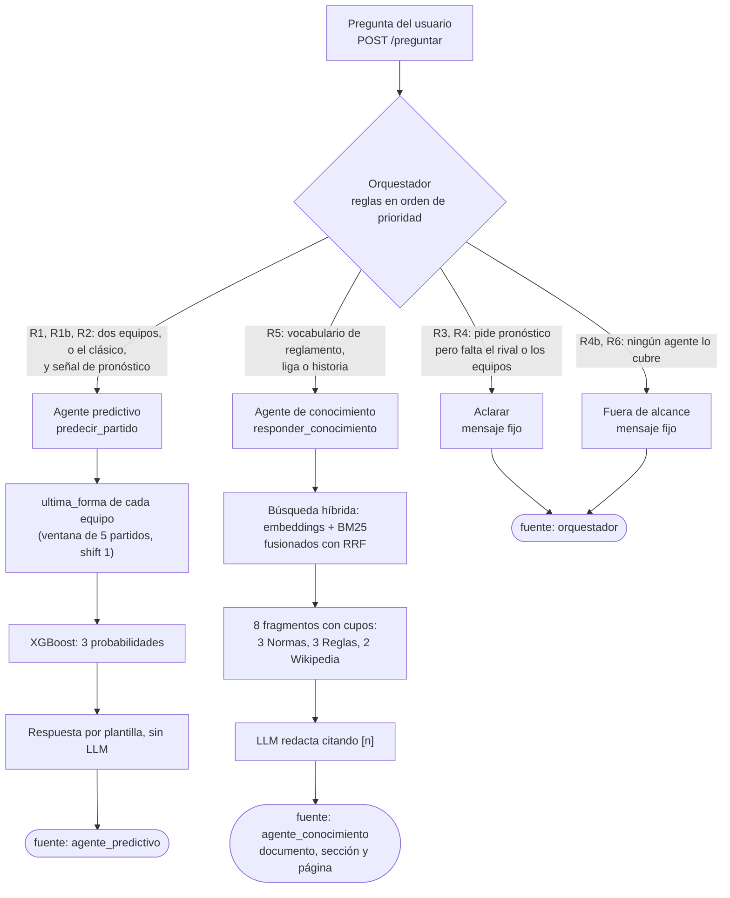
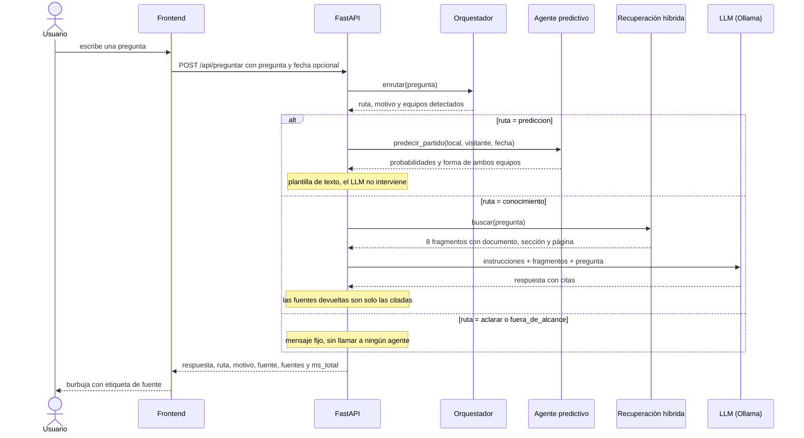

# Arquitectura

Sistema de tres agentes detrás de una sola API. Una pregunta entra por `POST /preguntar`; el **orquestador** decide con
reglas (sin LLM) a quién se la da; cada respuesta indica su **fuente** (RF07): `agente_predictivo`, `agente_conocimiento`
u `orquestador` (cuando aclara o declina). Las cifras citadas aquí salen de [`mediciones.md`](mediciones.md).

## 1. Componentes y despliegue

En desarrollo no hay Docker: Vite sirve la UI en `:5173` y llama directo a la API en `:8000` (CORS permitido solo para ese origen).

## 2. Flujo de una pregunta

## 3. Secuencia

Si Ollama está apagado, la ruta de conocimiento devuelve 503 y la interfaz lo muestra como «no disponible»; la predicción
sigue funcionando porque no depende del LLM (probado, ver `docs/frontend.md`).

## 4. Decisiones clave y por qué

| Decisión | Por qué | Evidencia |
|---|---|---|
| **Router por reglas, no por LLM** | Determinista y auditable (cada decisión devuelve su `motivo`), sin latencia añadida y sin competir por los ~5 GB de VRAM con el RAG. El dominio es cerrado: dos capacidades que el vocabulario distingue bien. Coste asumido: lo que no está en el vocabulario cae en `aclarar` o `fuera_de_alcance`, que son respuestas seguras. | `diseno_orquestador.md`; 12/12 en el heldout de v1, con las salvedades de `mediciones.md` (conjuntos pequeños, redactados por la misma persona que las reglas). |
| **XGBoost con `class_weight` balanceado, split cronológico y solo features con `shift(1)`** | Evita la fuga de datos: nunca se usan columnas del propio partido (xG, tiros, goles). Un split aleatorio sobreestimaría el rendimiento. | Log-loss 1,0513 en prueba frente a 1,0663 de la línea base: la ventaja es real pero pequeña. |
| **Probabilidades sin calibrar** | Recalibrar exige reentrenar sin la temporada de calibración y tocar el `.pkl`, y eso se deja a decisión del autor. Se documenta el sesgo en vez de ocultarlo. | El modelo sobreestima el empate (0,34 predicho, 0,26 real) y subestima la local (0,34 frente a 0,45). Platt multinomial propuesto, no aplicado. |
| **Respuesta de predicción por plantilla** | Un LLM podría reescribir o redondear las probabilidades. La plantilla es exacta, instantánea y siempre aclara quién es local. | Predicción: 299 ms por `/preguntar` (una medición). |
| **Fecha por defecto = último dato + 7 días a las 17:30** | El modelo nunca vio descansos menores de 2 días ni de ~500. Usar «hoy» o «mañana» daba entradas fuera de su rango. La respuesta lo avisa. | `datos.md`, «Desfase entrenamiento-inferencia»; prueba automática en `backend/tests`. |
| **RAG híbrido (embeddings + BM25 con RRF) y cupos por fuente** | El modelo de embeddings solo ve ~128 tokens y falla con palabras exactas del reglamento («suplentes», «amonestaciones»); BM25 las captura. Los cupos evitan que una fuente ruidosa y larga (Reglas de Juego, 678 chunks) ocupe todo el contexto que ve el LLM. | Con RAG 9/11 frente a 4/11 sin RAG (misma batería, mismo LLM). |
| **Chunks de ≤ 500 caracteres con metadata `documento`, `seccion`, `pagina`, `division`** | Caben en la ventana del modelo de embeddings y permiten citar documento y página (RF07). | Convención del proyecto (`CLAUDE.md`). |
| **Alcance: solo Primera División** | Los Art. 10 (Primera) y 17 (Segunda) son casi idénticos y el segundo contaminaba las respuestas de desempate. Los artículos de Segunda se excluyen salvo que la pregunta diga «segunda». | Recuperación 16/17 → 17/17; «desempate» dejó de traer el Art. 17. |
| **LLM detrás de la interfaz de LangChain** | Cambiar de proveedor es cambiar un solo bloque (`crear_llm`). La decisión del LLM de despliegue sigue pendiente. | qwen2.5:7b: 9/11 y 2.853 ms. qwen2.5:3b: 7/11 y 1.347 ms. |
| **`num_ctx` = 2048** | Libera VRAM y sube la velocidad; el prompt más largo medido fue de 1.532 tokens. Si se sube `k` o el tamaño de chunk hay que volver a medir, porque Ollama trunca en silencio. | 19,6–21,4 tok/s frente a 17,4–19,5 con 4096. |
| **Ollama fuera de Docker** | Usa la GPU del anfitrión y sus modelos ya descargados; la imagen no necesita CUDA. | `despliegue.md`. |
| **Datos por volumen de solo lectura y copia del índice de Chroma al arrancar** | Los datos no están en Git y pesan. Chroma abre su SQLite en escritura, así que se trabaja sobre una copia y el índice del anfitrión nunca se toca. | `docker-entrypoint.sh`. |
| **nginx como proxy de `/api` en vez de abrir CORS** | El navegador ve un solo origen. | `despliegue.md`. |
| **No actualizar los datos** | El CSV parece de Understat, que prohíbe el rastreo; football-data.org no trae xG ni PPDA, y mezclar fuentes obligaría a reabrir las 12 features. | `datos.md`. |

## 5. Dónde mirar en el código

| Pieza | Archivo |
|---|---|
| Arranque, `/predict`, `/teams`, `/health` | `backend/app/main.py` |
| Orquestador y `POST /preguntar` | `backend/app/orquestador.py` |
| Agente de conocimiento y `POST /chat` | `backend/app/chat.py` |
| Búsqueda híbrida | `backend/app/retrieval.py` |
| Agente predictivo | `backend/app/prediction.py` |
| Scripts de evaluación | `backend/scripts/` |
